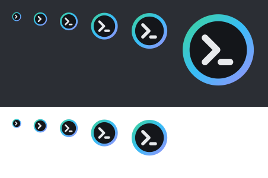

# Claude Session Deck

在 Windows Terminal 里同时跑着好几个 [Claude Code](https://claude.com/claude-code) 会话时,用一个常驻的悬浮窗统一查看它们的状态,点一下就跳到对应的终端窗口、标签页和窗格。

<p align="center"></p>

## 功能

- **会话总览**:自动列出所有在 Windows Terminal 里运行的 Claude Code 会话,显示名称、目录和状态(`busy` / `idle` / `closed`)。
- **一键跳转**:点击会话,直接切到它所在的窗口、标签页和分屏窗格;会话已关闭时,用 `claude --resume` 在新窗口里恢复。
- **悬浮气泡**:不用时折叠成一个小圆球,圆球里的数字是正在运行的会话数;可以固定展开、拖动、缩放,位置会被记住。
- **重命名**:在列表里重命名正在运行且空闲的会话,名称会同步回 Claude Code。
- **自愈**:钩子漏登记的会话会自动补上,异常退出的会话会自动清掉,窗口被拖到别处也能跟上(见[工作原理](#工作原理))。

## 环境要求

| 项目 | 要求 |
|---|---|
| 操作系统 | Windows 10 / 11 |
| 终端 | [Windows Terminal](https://aka.ms/terminal)(其他终端里的会话不会被登记) |
| Claude Code | 已安装,且会写 `~/.claude/sessions/<pid>.json`(在 2.1.284 上验证过;更旧的版本缺少这个文件,会退回到只靠钩子和进程检查) |
| 构建 | 系统自带的 .NET Framework 4 编译器(`csc.exe`,C# 5),**不需要**安装 SDK |

## 快速开始

### 1. 构建

```powershell
powershell -NoProfile -File .\build.ps1
```

生成两个程序:

| 文件 | 类型 | 用途 |
|---|---|---|
| `claude-session-deck.exe` | 控制台程序 | 供 Claude Code 钩子调用,以及命令行工具 |
| `claude-session-deck-gui.exe` | 窗口程序 | 悬浮窗本体 |

两个程序由同一份源码编译,功能完全一样,区别只在编译目标:控制台程序运行时带控制台窗口,能读写标准输入输出;窗口程序没有控制台窗口,不会闪黑框。

- **钩子请用 `claude-session-deck.exe`**:钩子需要从标准输入读取 JSON。
- **悬浮窗由 `claude-session-deck-gui.exe` 启动**:常驻后台,不带黑框。它无法启动时(见下方"常见问题"),会自动改用 `claude-session-deck.exe overlay`。
- 旧版本使用 `ccs.exe` / `ccs-gui.exe` 这两个名字,现已不再生成;如果钩子里还写着旧名字,请改成上面的新名字,否则钩子运行的是不会再更新的旧程序。

### 2. 注册 Claude Code 钩子

把下面的内容合并进 `~/.claude/settings.json`(路径换成你自己的):

```json
{
  "hooks": {
    "SessionStart": [
      {
        "matcher": "startup|resume|fork|clear",
        "hooks": [
          {
            "type": "command",
            "command": "C:/path/to/claude-session-deck/claude-session-deck.exe hook start",
            "timeout": 20
          }
        ]
      }
    ],
    "SessionEnd": [
      {
        "hooks": [
          {
            "type": "command",
            "command": "C:/path/to/claude-session-deck/claude-session-deck.exe hook end",
            "timeout": 5
          }
        ]
      }
    ]
  }
}
```

之后每次在 Windows Terminal 里启动 Claude Code,悬浮窗会自动随之启动(已在运行则不会重复启动)。也可以手动运行 `claude-session-deck-gui.exe`。

重新构建后无需改动钩子配置,路径不变即可;但要先退出正在运行的悬浮窗,否则 exe 被占用无法覆盖。

## 使用

| 操作 | 效果 |
|---|---|
| 点击气泡 | 展开会话列表 |
| 点击某个会话 | 聚焦它的窗口、标签页和窗格;已关闭的会话会恢复 |
| 右键会话 | `Open` 打开 / `Rename...` 重命名 / `Unregister` 取消登记 |
| 列表头部的图钉 | 固定展开,不自动折叠成气泡 |
| 拖动头部 / 边缘 | 移动 / 缩放列表;折叠后可拖动气泡 |
| 托盘图标 | 左键显示/隐藏;右键菜单 `Show / hide`、`Quit` |

### 命令行

```text
claude-session-deck.exe                     启动悬浮窗(已在运行则什么也不做)
claude-session-deck.exe open <名称>         聚焦某个会话
claude-session-deck.exe rename <旧名> <新名> 重命名正在运行且空闲的会话
claude-session-deck.exe hook start|end      Claude Code 钩子入口(从标准输入读取 JSON)
claude-session-deck.exe overlay             在当前进程里运行悬浮窗
```

## 工作原理

会话信息来自三个互相印证的来源,所以任何一个漏掉都不会让列表失真:

1. **钩子(快速路径)**:`SessionStart` / `SessionEnd` 事件到达时立即登记或移除,并记录会话所在的窗口和窗格。
2. **Claude Code 自己的注册表(事实来源)**:Claude Code 会为每个进程维护 `~/.claude/sessions/<pid>.json`,内含进程号、会话 ID、名称和 `busy` / `idle` 状态。悬浮窗每秒读取一次,并和 `sessions.json` 对账:
   - 漏登记(钩子没触发、被跳过)的会话会补上;
   - 进程已不存在的会话会清掉;终端被强行关闭时 `SessionEnd` 不会触发,靠这一步兜底;
   - 用进程创建时间区分"同一个 PID 被别的进程复用";
   - `/clear` 换了会话 ID、在 Claude Code 里改了名字,都会自动同步。
3. **控制台伪窗口(窗口归属)**:附加到 claude 进程的控制台,取其伪控制台窗口的所有者,就是显示它的 Windows Terminal 窗口。不依赖"启动时哪个窗口在前台",每 10 秒重新解析一次,标签页被拖到别的窗口也能跟上。

"是否在运行"只看进程是否存在,不依赖标签页标题;标签页标题只在聚焦时用来定位标签。

## 配置与数据

所有数据文件都保存在程序所在目录,不写注册表:

| 文件 | 内容 |
|---|---|
| `sessions.json` | 已登记的会话(名称、目录、会话 ID、进程号、窗格) |
| `sessions.windows.json` | 会话名称到终端窗口句柄的映射 |
| `overlay.json` | 悬浮窗/气泡的位置、大小和是否固定 |
| `hook.log` | 钩子与对账的日志,排查问题先看它 |

环境变量(主要给测试用):

| 变量 | 作用 |
|---|---|
| `DECK_STORE` | 改用另一个 `sessions.json` 路径 |
| `DECK_CLAUDE_HOME` | 改用另一个 Claude 配置目录(默认 `~/.claude`) |
| `DECK_NO_OVERLAY` | 设置后,钩子不会顺带启动悬浮窗 |

## 项目结构

```text
claude-session-deck/
├── src/                    C# 源码
│   ├── Program.cs          命令行入口
│   ├── Hook.cs             SessionStart / SessionEnd 钩子
│   ├── Registry.cs         读取 Claude Code 的会话注册表
│   ├── Reconcile.cs        对账(纯函数)与窗口归属
│   ├── Store.cs            sessions.json / sessions.windows.json
│   ├── Native.cs           Win32:窗口、控制台、进程
│   ├── Tabs.cs             通过 UI Automation 操作终端标签页和窗格
│   ├── SessionOpener.cs    聚焦或启动会话
│   ├── Rename.cs           重命名
│   ├── Overlay.cs          悬浮窗与托盘
│   ├── SessionCanvas.cs    列表的绘制
│   ├── Bubble.cs           折叠后的气泡
│   └── AppIcon.cs          内嵌图标的读取
├── tests/                  单元测试
├── icon/                   图标与生成脚本
├── build.ps1               构建
├── test.ps1                运行测试
└── app.manifest            DPI 感知等清单
```

## 开发

```powershell
powershell -NoProfile -File .\test.ps1            # 构建并运行单元测试,全部通过时退出码为 0
powershell -NoProfile -File .\icon\make-icon.ps1  # 修改图标设计后重新生成 icon\app.ico
```

- 测试覆盖对账逻辑(补登记、清理、PID 复用、`/clear`、重命名冲突等)和注册表解析,都是不接触系统的纯函数测试。
- 编译器是 C# 5:不要使用 `?.`、字符串插值、`nameof`、表达式体成员等新语法。
- 重新构建前需要先退出正在运行的悬浮窗(托盘图标右键 `Quit`),否则 `claude-session-deck-gui.exe` 会被占用。

## 常见问题

**悬浮窗里看不到我的会话**
先看 `hook.log`。会话必须运行在 Windows Terminal 里;在 VS Code 终端、conhost 等里启动的会话不会被登记。

**悬浮窗启动不了,提示"与你运行的 Windows 版本不兼容"**
文件被安全软件(例如企业的文件加密软件)改写过,正常的程序文件开头两个字节是 `MZ`。重新运行 `build.ps1` 即可;此时钩子会自动改用 `claude-session-deck.exe overlay` 启动窗口。建议让 IT 把本目录加入排除范围。

**点击会话后没有落在正确的分屏窗格**
窗格信息只有在钩子触发时(你正在那个窗格里)才能记录。被对账补登记的会话没有窗格信息,聚焦时退回按标签页标题查找。

## 许可证

暂未指定许可证。
